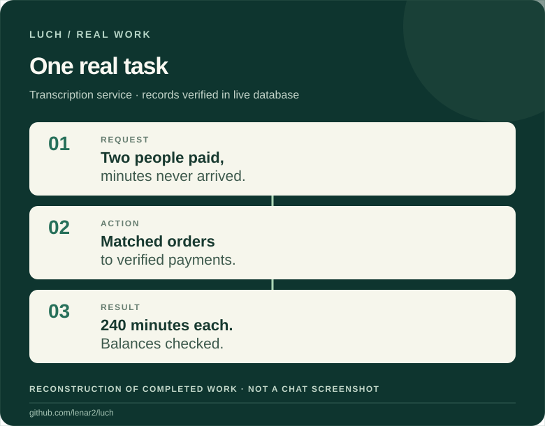
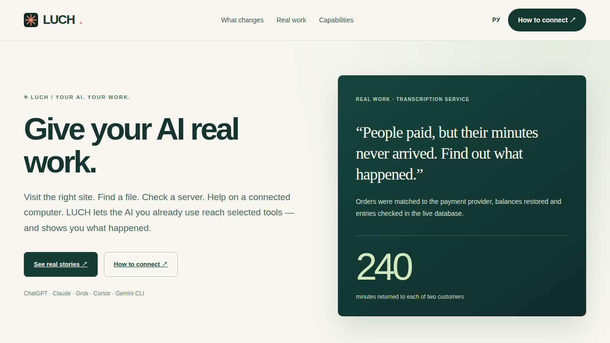

<h1 align="center">LUCH</h1>

<strong>Your tools. Your choices. Your AI.</strong>

Describe a task in the AI conversation you already use. LUCH lets your AI reach authorized websites, files, devices and servers — and helps you verify what actually happened.

<a href="#how-luch-works">See real work</a> · <a href="#getting-started">Get started</a> · <a href="https://luch.lenarsalimov.ru/en/">Explore the site</a> · <a href="README.md">Русский</a>

## How LUCH works

**The problem:** two people paid for transcription minutes, but the minutes never reached their accounts.

<picture><source media="(max-width: 600px)" srcset="docs/media/luch-real-work-en-mobile.svg"></picture>

**The result:** **240 minutes restored to each customer**. The live records were checked and unrelated balances left untouched. [The full account and evidence boundaries](docs/REAL_JOBS.md). *This diagram reconstructs the stages of a real completed job; it is not an interface screenshot.*

LUCH is being built for work that needs to continue beyond an AI's advice — into tools, authorized actions and checkable outcomes.

## One environment, many kinds of work

**Websites and browsers.** Read, navigate, click, type and capture pages. Public websites can use an isolated server-side Firefox. Your personal signed-in tabs require a separate computer connection.

**Computers and files.** Find documents, compare materials, prepare edits; on an authorized Mac, interact with windows, applications and the terminal.

**Servers and services.** Investigate issues, take explicitly approved actions and inspect results. Server tasks can run independently of your personal Mac.

**One platform, not a separate product for every tool.** LUCH Core is intended as a free foundation for supported authorized resources, subject to safety and fair-use limits. The Developer Platform is a future path for third-party AI products to receive scoped access from resource owners; self-service developer onboarding is not claimed as available.

[All 12 capabilities](docs/CAPABILITIES.md) · [Safety and permissions](https://luch.lenarsalimov.ru/en/safety/) · [More real cases](docs/REAL_JOBS.md)

## Use the AI you already know

LUCH has been used for real work in **ChatGPT, Claude and Grok**. In **ChatGPT**, it has been used in ordinary chats and **Work**. **Cursor** and **Gemini CLI** have separate integration paths. New account availability differs between hosts.

The project has used **Chrome, Opera, Opera Neon, Yandex Browser, Edge, Brave, Firefox and Safari**, with different levels of retained evidence. Connected **Mac** and authorized **Linux server** workflows are demonstrated; a dedicated Windows end-to-end test is outstanding, and native Windows app control is not claimed.

[Compatibility, with evidence boundaries](docs/COMPATIBILITY.md)

## Getting started

**Already connected?** Begin with a read-only task:

> “Which LUCH tools are available to you right now? Then read these two public pages, compare them and cite your sources.”

Review what actually happened before authorizing any write actions.

**Not yet connected?** [Choose your AI and check access](docs/START_HERE.md). Setup differs between ChatGPT, Claude, Grok, Cursor and Gemini CLI. Public source code does not imply open self-service sign-up.

[**Connection guide**](docs/START_HERE.md) · [Current availability](https://luch.lenarsalimov.ru/en/status/) · [Support](https://luch.lenarsalimov.ru/support/)

<strong>See the real LUCH website</strong>

LUCH · [Open-source repository](https://github.com/lenar2/luch) · [Privacy](https://luch.lenarsalimov.ru/privacy/) · [Terms](https://luch.lenarsalimov.ru/terms/) · [По-русски](README.md)
