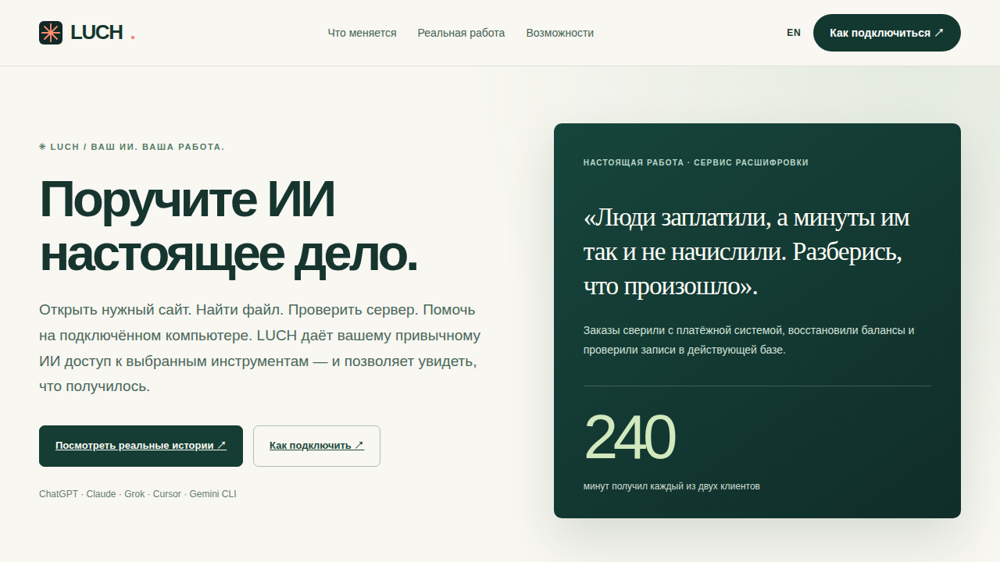

  

<h1 align="center">LUCH</h1>

  <strong>Поручите ИИ настоящее дело.</strong>

  Ваши сайты, файлы, компьютеры и серверы — в той же беседе с ИИ, которой вы уже пользуетесь. 
  Вы выбираете доступ. LUCH помогает выполнить задачу и проверить результат.

  <a href="https://luch.lenarsalimov.ru/ru/"><strong>Открыть сайт</strong></a>
  &nbsp; · &nbsp;
  <a href="https://luch.lenarsalimov.ru/ru/connect/">Как подключиться</a>
  &nbsp; · &nbsp;
  <a href="README.en.md">English</a>

## От просьбы — к сделанному

Описываете задачу своими словами. LUCH даёт выбранному ИИ доступ к разрешённым инструментам: сайту, документу, подключённому устройству или серверу. Вы видите, что произошло на самом деле.

**Три случая из реальной работы:**

| Что случилось | Что удалось сделать |
| --- | --- |
| Два человека оплатили расшифровку, но минуты не начислились. | Нашли успешные платежи, восстановили балансы — **по 240 минут каждому**, проверили данные. |
| Компьютер потерял соединение после сетевых изменений. | Проверили маршруты и прокси; на контрольном этапе восстановили **прямой Wi-Fi и HTTPS**. |
| Сайт оказался неудобным на узких экранах. | Исправили вёрстку, проверили **32 маршрута на четырёх размерах экрана** и опубликовали правку. |

[Посмотреть подробности и границы подтверждений](docs/REAL_JOBS.ru.md) · [Проверяемое изменение сайта](https://github.com/lenar2/luch/commit/06daa8d6b89a3dfd65e74628b895879e79a0c931)

## Работайте там, где вам удобно

| ИИ и разговор | Ваши инструменты |
| --- | --- |
| **ChatGPT** — обычные чаты и **Work** на разрешённом аккаунте. **Claude** и **Grok** тоже использовались в реальной работе с LUCH. Для **Cursor** и **Gemini CLI** подготовлены отдельные подключения. | **Браузер:** исследовать сайты, читать, нажимать, вводить, делать снимки. **Mac:** разрешённые окна, приложения, файлы, терминал. **Linux:** серверные команды, файлы, Firefox. |

В проекте работали с **Chrome, Opera, Opera Neon, Яндекс Браузером, Edge, Brave, Firefox и Safari**. Глубина сохранившихся проверок различается. Из Windows серверные инструменты архитектурно доступны через совместимый ИИ-клиент, но независимая Windows-проверка ещё не завершена.

[Все возможности](docs/CAPABILITIES.ru.md) · [Совместимость по сценариям](docs/COMPATIBILITY.ru.md) · [Все 12 навыков LUCH](docs/CAPABILITIES.ru.md)

## Начните с одного дела

Если LUCH уже подключён к вашему ИИ, попробуйте: *«Сравни эти две страницы, выдели важные различия и покажи источники».*

Для нового пользователя доступ зависит от аккаунта и способа подключения; **самостоятельный путь регистрации пока не подтверждён для всех**. Личные файлы и программы требуют отдельного разрешения. Управление Windows-приложениями не заявляется как проверенная функция.

  <a href="https://luch.lenarsalimov.ru/ru/connect/"><strong>Проверить подключение</strong></a>
  &nbsp; · &nbsp;
  <a href="docs/START_HERE.ru.md">Техническая инструкция</a>
  &nbsp; · &nbsp;
  <a href="https://luch.lenarsalimov.ru/ru/status/">Статус возможностей</a>

LUCH · <a href="https://luch.lenarsalimov.ru/privacy/">Конфиденциальность</a> · <a href="https://luch.lenarsalimov.ru/security/">Безопасность</a> · <a href="https://luch.lenarsalimov.ru/support/">Поддержка</a> · <a href="README.en.md">Read in English</a>
