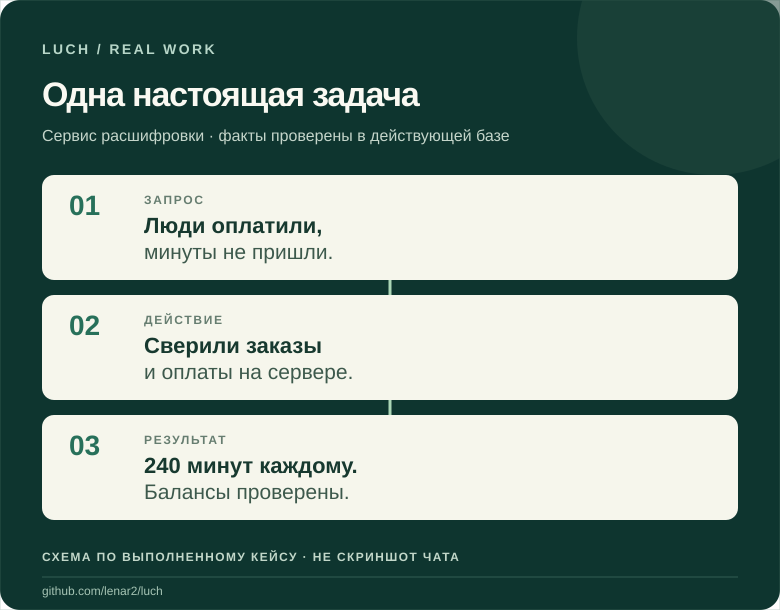

<h1 align="center">LUCH</h1>

<strong>Ваши инструменты. Ваш выбор. Ваш ИИ.</strong>

Вы описываете задачу в привычном ИИ-чате. LUCH даёт доступ к разрешённым сайтам, файлам, устройствам и серверам — и помогает проверить, что действительно сделано.

<a href="#как-luch-работает">Увидеть реальную работу</a> · <a href="#как-начать">Как начать</a> · <a href="https://luch.lenarsalimov.ru/ru/">Открыть сайт</a> · <a href="README.en.md">English</a>

## Как LUCH работает

**Задача:** два человека оплатили расшифровку, но не получили оплаченные минуты.

<picture><source media="(max-width: 600px)" srcset="docs/media/luch-real-work-ru-mobile.svg"></picture>

**Результат:** каждому восстановлено **240 минут**. Записи проверены в действующей базе; посторонние балансы не изменялись. [Полная история и границы доказательств](docs/REAL_JOBS.ru.md). *Схема показывает ход выполненного случая, но не является скриншотом интерфейса.*

Именно для этого создаётся LUCH: чтобы задача не обрывалась на совете от ИИ, когда дальше нужно действовать в реальных инструментах.

## Одна среда — разные задачи

**Браузер.** Исследовать сайты, переходить по страницам, читать, нажимать, вводить текст и получать снимки. Для открытых сайтов есть отдельный серверный Firefox. Доступ к вашим личным вкладкам требует подключения компьютера.

**Компьютер и файлы.** Найти материал, сопоставить документы, подготовить изменение; на разрешённом Mac — работать с окнами, приложениями и терминалом.

**Серверы и сервисы.** Проверить проблему, выполнить конкретное разрешённое действие, сверить результат. Работа с сервером не требует включённого домашнего Mac.

**Одна платформа, а не отдельный продукт на каждую функцию.** LUCH Core развивается как бесплатная основа для собственных разрешённых ресурсов с разумными лимитами. Developer Platform — направление для сторонних ИИ-продуктов, которым владелец сможет делегировать ограниченный доступ; общедоступный самостоятельный вход разработчиков пока не заявлен.

[Все 12 навыков](docs/CAPABILITIES.ru.md) · [Безопасность и разрешения](https://luch.lenarsalimov.ru/ru/safety/) · [Другие выполненные задачи](docs/REAL_JOBS.ru.md)

## Работайте в привычном ИИ

Через **ChatGPT, Claude и Grok** LUCH уже использовался в реальной работе. В **ChatGPT** он применялся и в обычном чате, и в **Work**. Для **Cursor** и **Gemini CLI** есть отдельные интеграции. Не все способы подключения доступны новым аккаунтам.

В проекте использовали **Chrome, Opera, Opera Neon, Яндекс Браузер, Edge, Brave, Firefox и Safari**. Подтверждения по браузерам различаются. **Mac** и разрешённый **Linux-сервер** проверены; независимый сквозной тест Windows ещё не завершён, управление его приложениями отдельно не обещается.

[Совместимость без преувеличений](docs/COMPATIBILITY.ru.md)

## Как начать

**LUCH уже подключён к вашему ИИ?** Начните без изменения данных:

> «Какие инструменты LUCH у тебя доступны сейчас? Затем прочитай эти две публичные страницы, сравни их и покажи ссылки на источники».

Посмотрите, что действительно выполнено, прежде чем разрешать запись или изменение ресурсов.

**Подключения ещё нет?** [Выберите свой ИИ и проверьте доступ](docs/START_HERE.ru.md). Для ChatGPT, Claude, Grok, Cursor и Gemini CLI пути отличаются. Публикация исходников не означает, что самостоятельная регистрация нового пользователя уже открыта.

[**Путь подключения**](docs/START_HERE.ru.md) · [Текущий статус](https://luch.lenarsalimov.ru/ru/status/) · [Помощь](https://luch.lenarsalimov.ru/support/)

<strong>Показать настоящий сайт LUCH</strong>

LUCH · [Исходный код](https://github.com/lenar2/luch) · [Конфиденциальность](https://luch.lenarsalimov.ru/privacy/) · [Условия](https://luch.lenarsalimov.ru/terms/) · [English](README.en.md)
