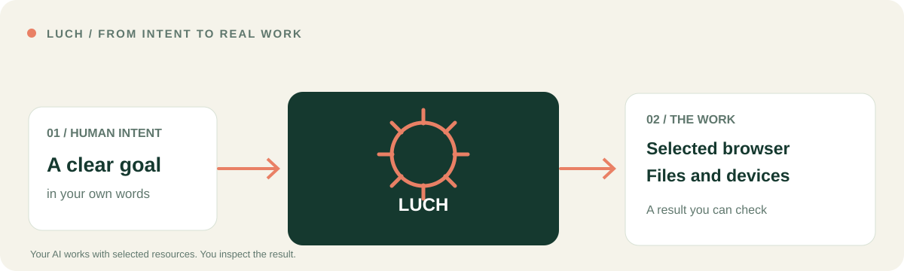

# LUCH
### I’m building LUCH so I can give AI real work to do from the chat I already use.

I connect LUCH to the AI I already use, so I can give it work involving websites, files, computers and servers. I choose which resources it may access and can inspect the results of consequential actions.

[**Explore every capability**](docs/CAPABILITIES.md) · [**A real result**](docs/REAL_WORK.md) · [**Connect your AI**](docs/START_HERE.md) · [Русский](README.ru.md) · [Website](https://luch.lenarsalimov.ru/en/)

## What I have already done with LUCH

I use LUCH every day. These three jobs show what becomes possible when AI has access to the right tools.

### 01 · Restoring access for paying customers

A live audio-to-text service had accepted payments, but the associated minutes had not reached the customers' balances.

**Through my authorized cloud server,** the work traced the original transactions to the payment provider, reconciled the exact affected accounts, restored **240 minutes to each of two customers**, verified the ledger and sent two separate Telegram apologies. Other customers and canceled orders were left unchanged.

The work compared actual payment-provider records with production database entries, then checked the restored balances again.

### 02 · Recovering a computer's internet connection

A system configuration change had interrupted the computer's connection. I needed direct internet restored while keeping the available remote access routes intact.

**Through authorized computer and terminal access,** the recovery checked network routes, proxy settings, running services and the connection path, then established a working direct Wi-Fi route without the phone connection at the recorded checkpoint. Long-term stability remained a separate check.

The checks covered real network settings and external service responses. Long-term connection stability was tracked separately.

### 03 · Fixing and publishing a website

I asked for a human-centered bilingual redesign. The work inspected the actual website and GitHub source, checked **32 routes at four screen sizes**, found a narrow-screen defect, corrected it and published the approved version.

[**See the public source commit and the real result →**](docs/REAL_WORK.md)

The exact source commit remains available for anyone who wants to inspect what changed.

[**Read all three real stories and their evidence limits →**](docs/REAL_JOBS.md)

*The prompts above describe the intent of each task; they are not presented as verbatim transcripts. The website release has public source evidence. The customer-restoration and computer-recovery logs contain private operational data and are summarized here without exposing accounts, secrets or personal files. These founder-environment cases do not establish that every new account has all routes enabled.*

## Where can I use LUCH?

**In a normal ChatGPT conversation?** Yes. I use LUCH in ordinary ChatGPT text chats with my connected account. I describe the task in natural language, and ChatGPT calls the tools actually available in that conversation. Work mode is not required for this integration.

**With other AI clients?** The platform also has integrations for Claude, Cursor and Gemini CLI. Claude uses its supported plugin flow; Cursor works in the editor and Gemini CLI in the terminal. Each client and account has its own setup and permissions.

**Which browsers?** LUCH can use an isolated Firefox-based browser on a server to work with public websites, without opening your computer's browser. Working in your *existing signed-in session* is separate: local Chrome and Opera have been exercised in my connected environment. Compatibility with every Chrome-based browser, Firefox local profiles and Safari is not yet verified.

**Which computers?** Connected macOS desktop controls and Linux server commands are demonstrated. I do not claim equivalent Windows desktop control, or full native control of iPhone and Android, without a separate verified connection.

**Do I need to install anything?** For enabled chat-based server/web tasks, a separate desktop application is not needed. To reach files, local tabs or apps on a particular computer, that device must be paired with permission. New-user self-service activation is still being verified.

[**Full compatibility and practical setup →**](docs/COMPATIBILITY.md) · [**Choose my AI →**](docs/START_HERE.md)

## The full LUCH experience

**12 documented skills. One connected way of working.** I have organized the public capabilities by the part of your life or work they can improve, rather than by internal API names.

### Understand and navigate the web

| What I want AI to help with | What LUCH provides |
| --- | --- |
| **Explore public websites** | An isolated server browser: navigate pages, follow links, read content, enter text, click and capture screenshots in a permitted session |
| **Work in my own browser** | A separately authorized local browser or profile when an existing signed-in session is genuinely needed |
| **Manage a task's tabs** | Inspect and operate granted tabs and windows, preserving the rest of your browsing session |

[Browser, local browser and tabs →](docs/CAPABILITIES.md#browser-and-web)

### Work with my files, apps and devices

| What I want AI to help with | What LUCH provides |
| --- | --- |
| **Find and work with files** | Search, read, compare, create or edit selected files and folders, with verification and sensible backups |
| **Use a connected computer** | Where available, inspect the screen and work with native apps, windows, mouse and keyboard on the exact permitted device |
| **Inspect my servers** | Discover a selected paired server, read its status and run bounded terminal diagnostics |

[Files, computer and server →](docs/CAPABILITIES.md#files-devices-and-servers)

### Connect services and carry work across steps

| What I want AI to help with | What LUCH provides |
| --- | --- |
| **Work with a linked service** | Use a supported service API or approved browser session within my account's permissions |
| **Complete multi-step tasks** | Coordinate browser, files, server and other exposed tools; check actual outcomes rather than just reporting “done” |
| **Know what is available** | Discover the real tools, connected resources and permissions in this specific session |
| **Stay in control** | Select the target, confirm important changes, keep access limited, and diagnose connection or permission problems |

[Services, workflows, access and troubleshooting →](docs/CAPABILITIES.md#services-workflows-and-control)

A capability in a public skill is **not automatically an available tool** on every device or AI host. The full map distinguishes demonstrated actions, device-dependent routes and future features.

## One LUCH, different ways to begin

| Your AI | A useful starting point | Integration |
| --- | --- | --- |
| **ChatGPT** | Research a question with source-backed comparisons | [ChatGPT candidate](https://github.com/lenar2/luch-claude-plugin/tree/main/integrations/chatgpt/) |
| **Claude** | Connect selected documents and sources into a decision brief | [Claude plugin](https://github.com/lenar2/luch-claude-plugin) |
| **Cursor** | Diagnose a code problem against a selected environment and prepare a patch | [Cursor plugin](https://github.com/lenar2/luch-cursor) |
| **Gemini CLI** | Check a paired server and turn observed output into an operational report | [Gemini extension](https://github.com/lenar2/luch-gemini) |

These are examples of how each host can use the LUCH tool set where the necessary tools and grants are exposed — not four different products.

[Choose your connection path](docs/START_HERE.md) · [Host-specific readiness](docs/RELEASE_READINESS.md)

## The direction I am building toward

**LUCH Core** is intended as a free set of tools for working with your own authorized resources, subject to sensible security and capacity limits. A separate managed-agent service for longer autonomous work is a future direction, **not a product currently being sold**.

My principle is simple: **the task belongs to the human; the tools are there to help it move.** Your permissions, your ability to inspect what happened, and your decision about consequential changes remain central.

---

[Full capabilities](docs/CAPABILITIES.md) · [Product site](https://luch.lenarsalimov.ru/en/) · [Safety](https://luch.lenarsalimov.ru/en/safety/) · [Privacy](https://luch.lenarsalimov.ru/privacy/) · [Support](https://luch.lenarsalimov.ru/support/)

For developers and reviewers

This repository is the public LUCH platform hub and website source. The 12 portable skills live in the separate client repositories; they are workflow descriptions, not an implicit grant of runtime tools. The hosted backend, credentials and user device permissions are not published here.

[Technical setup](https://luch.lenarsalimov.ru/docs/get-started/) · [Security](SECURITY.md) · [Contributing](CONTRIBUTING.md) · [Release-readiness gates](docs/RELEASE_READINESS.md). The Apache-2.0 license applies to this repository's public files, not the hosted service or other packages.

