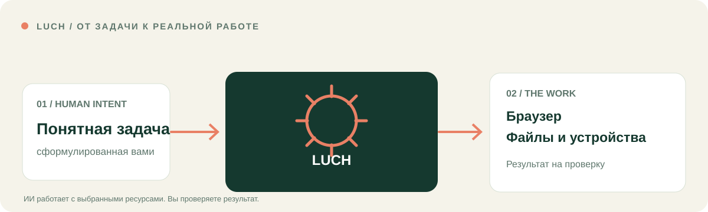

# LUCH
### Я хочу, чтобы ИИ не только отвечал, но и помогал делать.

Я создаю **LUCH, чтобы соединить ИИ с реальной работой в цифровом мире**. Это не ещё одно окно чата, а связь с выбранными вами браузерами, файлами, приложениями, устройствами, серверами и сервисами. ИИ может исследовать, сравнивать, готовить изменения и — при необходимом разрешении — действовать, показывая, что получилось.

[**Все возможности LUCH**](docs/CAPABILITIES.ru.md) · [**Настоящий результат**](docs/REAL_WORK.ru.md) · [**Подключить свой ИИ**](docs/START_HERE.ru.md) · [English](README.md) · [Сайт](https://luch.lenarsalimov.ru/ru/)

## Вся сила LUCH

**12 описанных навыков. Один способ связать разные инструменты с задачей.** Я показываю возможности через понятные дела, а не через названия внутренних API.

### Исследовать интернет и работать в браузере

| Что я хочу поручить ИИ | Что даёт LUCH |
| --- | --- |
| **Исследовать публичные сайты** | Изолированный серверный браузер: открывать страницы, переходить по ссылкам, читать, вводить текст, нажимать, делать снимки в разрешённой сессии |
| **Работать в своём браузере** | Отдельно разрешённый локальный браузер или профиль, когда действительно нужна ваша существующая авторизованная сессия |
| **Управлять вкладками задачи** | Работать с разрешёнными вкладками и окнами, сохраняя остальные страницы человека |

[Браузеры и вкладки — подробно →](docs/CAPABILITIES.ru.md#браузер-и-веб)

### Работать с файлами, программами и устройствами

| Что я хочу поручить ИИ | Что даёт LUCH |
| --- | --- |
| **Находить и менять материалы** | Поиск, чтение, сравнение, создание и редактирование выбранных файлов и папок с проверкой результата и сохранением оригинала |
| **Работать на подключённом компьютере** | Там, где поддерживается: экран, окна, программы, мышь и клавиатура точно выбранного устройства |
| **Проверять серверы** | Поиск разрешённого подключённого сервера, его статус и ограниченная диагностика через терминал |

[Файлы, компьютер и серверы — подробно →](docs/CAPABILITIES.ru.md#файлы-устройства-и-серверы)

### Подключать сервисы и доводить работу до результата

| Что я хочу поручить ИИ | Что даёт LUCH |
| --- | --- |
| **Работать со своим сервисом** | Поддерживаемое API сервиса или разрешённая браузерная сессия с правами моего аккаунта |
| **Проводить сложные задачи** | Несколько этапов через доступные браузер, файлы и сервер, с проверкой фактических результатов |
| **Понимать, что сейчас доступно** | Обнаружение действующих инструментов, подключённых ресурсов и разрешений текущей сессии |
| **Контролировать действия** | Выбор конкретной цели, отдельное подтверждение важных изменений, ограниченный доступ и диагностика ошибок подключения |

[Сервисы, сложные сценарии и управление — подробно →](docs/CAPABILITIES.ru.md#сервисы-сценарии-и-контроль)

Описанный навык **не означает**, что соответствующий инструмент автоматически доступен на любом устройстве или в любом ИИ-клиенте. В полной карте я отдельно показываю подтверждённые действия, возможности подключённых устройств и будущие направления.

## Что я уже сделал с помощью LUCH

Я хотел переделать сайт LUCH так, чтобы он говорил о человеческих задачах, а не об инженерной терминологии. ИИ через разрешённые мной инструменты изучил действующий сайт и исходники GitHub, подготовил двуязычные изменения, проверил **32 страницы на четырёх размерах экрана**, исправил мобильную проблему и опубликовал обновление после моего разрешения.

**Это реальный результат, который можно проверить**, а не придуманная демонстрация.

[Мой рассказ о работе](docs/REAL_WORK.ru.md) · [Точный коммит](https://github.com/lenar2/luch/commit/06daa8d6b89a3dfd65e74628b895879e79a0c931) · [Проверки выпуска](https://github.com/lenar2/ai-factory-evidence/issues/4009#issuecomment-6692683064)

## Один LUCH — разные способы начать

| Ваш ИИ | С какой задачи начать | Интеграция |
| --- | --- | --- |
| **ChatGPT** | Исследовать вопрос и получить сравнение с источниками | [Кандидат ChatGPT](https://github.com/lenar2/luch-claude-plugin/tree/main/integrations/chatgpt/) |
| **Claude** | Соединить выбранные документы и источники в записку для решения | [Плагин Claude](https://github.com/lenar2/luch-claude-plugin) |
| **Cursor** | Разобраться с проблемой кода в выбранной среде и подготовить правку | [Плагин Cursor](https://github.com/lenar2/luch-cursor) |
| **Gemini CLI** | Проверить подключённый сервер и превратить вывод диагностики в понятный отчёт | [Расширение Gemini](https://github.com/lenar2/luch-gemini) |

Это примеры использования единого набора возможностей LUCH в разных интерфейсах, если необходимые инструменты и разрешения доступны.

[Выбрать путь подключения](docs/START_HERE.ru.md) · [Статус интеграций](docs/RELEASE_READINESS.md)

## Куда я развиваю LUCH

**LUCH Core** задуман как бесплатный набор инструментов для работы с собственными разрешёнными ресурсами, с разумными ограничениями безопасности и нагрузки. Отдельный сервис управляемых агентов для длительной автономной работы — будущее направление, **сейчас это не продаваемый продукт**.

Мой принцип: **дело принадлежит человеку, а инструменты помогают ему двигаться**. Вы решаете, к чему дать доступ, видите результат и отдельно одобряете значимые изменения.

---

[Все возможности](docs/CAPABILITIES.ru.md) · [Сайт LUCH](https://luch.lenarsalimov.ru/ru/) · [Безопасность](https://luch.lenarsalimov.ru/ru/safety/) · [Конфиденциальность](https://luch.lenarsalimov.ru/privacy/) · [Поддержка](https://luch.lenarsalimov.ru/support/)

Разработчикам и проверяющим

Здесь главный публичный репозиторий LUCH и исходники сайта. Двенадцать переносимых навыков находятся в клиентских репозиториях; описание сценария не выдаёт автоматически право на использование инструментов. Закрытый сервер, учётные данные и доступ к чужим устройствам здесь не публикуются.

[Техническое подключение](https://luch.lenarsalimov.ru/docs/get-started/) · [Безопасность](SECURITY.md) · [Участие](CONTRIBUTING.md) · [Критерии выпуска](docs/RELEASE_READINESS.md). Лицензия Apache-2.0 относится к открытым файлам этого репозитория, а не к размещённому сервису или другим пакетам.

