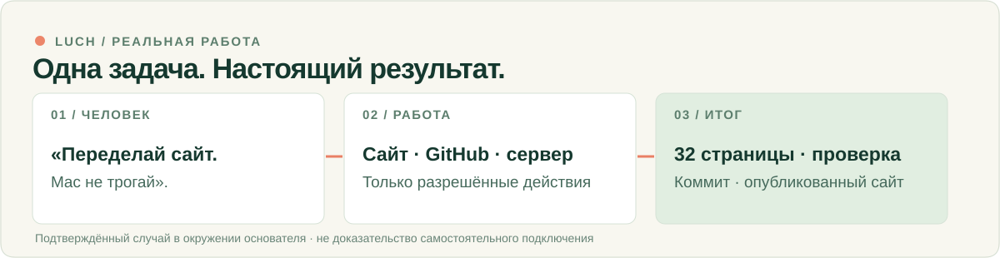

<!-- LUCH / Человеческий опыт / реальное доказательство -->

# LUCH
### Между «сделай» и результатом должно быть меньше лишней работы.

Вы знаете, что важно. **LUCH помогает вашему ИИ работать с разрешёнными сайтами, файлами и устройствами** — и возвращаться с результатом, который можно проверить. Решение остаётся за вами.

[**Посмотреть настоящую работу**](docs/REAL_WORK.ru.md) · [**Найти способ подключения**](docs/START_HERE.ru.md) · [English](README.md) · [Сайт](https://luch.lenarsalimov.ru/ru/)

---

## Одна настоящая задача вместо красивой схемы

**Запрос основателя, переданный своими словами:** «Сайт слишком технический. Переделай его для человека, Mac не трогай».

Это реальный запрос основателя в ноябре 2026 года. В разрешённом окружении ИИ изучил живой сайт и GitHub, подготовил двуязычную переработку, проверил 32 страницы на четырёх размерах экрана, исправил мобильный дефект и после разрешения выпустил сайт.

| Чего хотел человек | Что позволили инструменты | Что можно проверить |
| --- | --- | --- |
| Понятный сайт без вмешательства в Mac | Читать сайт, менять исходники GitHub, проводить проверки на сервере и выпускать согласованные изменения | [Точный коммит](https://github.com/lenar2/luch/commit/06daa8d6b89a3dfd65e74628b895879e79a0c931), [запись о выпуске](https://github.com/lenar2/ai-factory-evidence/issues/4009#issuecomment-6692683064), [живой сайт](https://luch.lenarsalimov.ru/ru/) |

**Важная граница:** подтверждена работа *в окружении основателя*, а не самостоятельное подключение любого нового пользователя. Выпуск сайта не означает окончательного признания качества дизайна. Позже [самоаудит](https://github.com/lenar2/ai-factory-evidence/issues/4009#issuecomment-6705944671) выявил недостатки, которые мы исправляем.

[**Разобрать этот случай с доказательствами**](docs/REAL_WORK.ru.md)

## Какое дело нужно сдвинуть?

| Ваша задача | Чем помогает LUCH | Что вы получаете |
| --- | --- | --- |
| Разобраться в информации | [Работа с разрешёнными сайтами](https://luch.lenarsalimov.ru/ru/browser/) | Сравнение или объяснение с источниками |
| Подготовить материал | [Разрешённые файлы и устройства](https://luch.lenarsalimov.ru/ru/computer/) | Черновик или правку на проверку |
| Исправить проблему разработки | [GitHub и разрешённые серверные инструменты](https://luch.lenarsalimov.ru/ru/platform/) | Причину и проверяемое изменение, а не незаметный релиз |

Это **возможности**, а не обещание, что они доступны любому аккаунту прямо сейчас.

## Ваш ИИ. Ваш выбор доступа.

**1. [Выберите способ подключения](docs/START_HERE.ru.md).** Для ChatGPT, Claude, Cursor и Gemini CLI — разные интеграции и условия.

**2. Сначала проверьте доступность.** LUCH работает у основателя, но независимое самостоятельное подключение нового пользователя пока не подтверждено. Установка пакета не создаёт аккаунт и не подключает устройство. [Текущий статус](https://luch.lenarsalimov.ru/ru/status/).

**3. Если аккаунт подключён — начните без записи.** Разрешите только нужную страницу, файл или устройство. Проверьте результат до выдачи более широкого доступа.

Разрешение — ваше. Принятый запрос ещё не выполненная работа. Подготовленная правка ещё не опубликованный релиз.

[Безопасность](https://luch.lenarsalimov.ru/ru/safety/) · [Конфиденциальность](https://luch.lenarsalimov.ru/privacy/) · [Условия](https://luch.lenarsalimov.ru/terms/) · [Поддержка](https://luch.lenarsalimov.ru/support/)

Разработчикам и проверяющим

Это главный продуктовый репозиторий LUCH. Исходники сайта — [`website/`](website/), интеграции — в отдельных репозиториях. Закрытого сервера, ключей и доступа к устройствам здесь нет. Технические материалы: [подключение](https://luch.lenarsalimov.ru/docs/get-started/), [безопасность](SECURITY.md), [участие](CONTRIBUTING.md), [критерии допуска](docs/RELEASE_READINESS.md). Лицензия Apache-2.0 относится к открытым файлам репозитория, не к размещённому сервису или другим клиентам.

